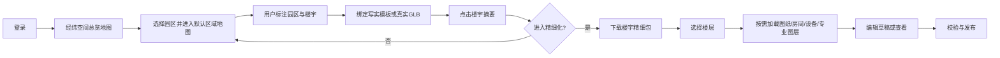
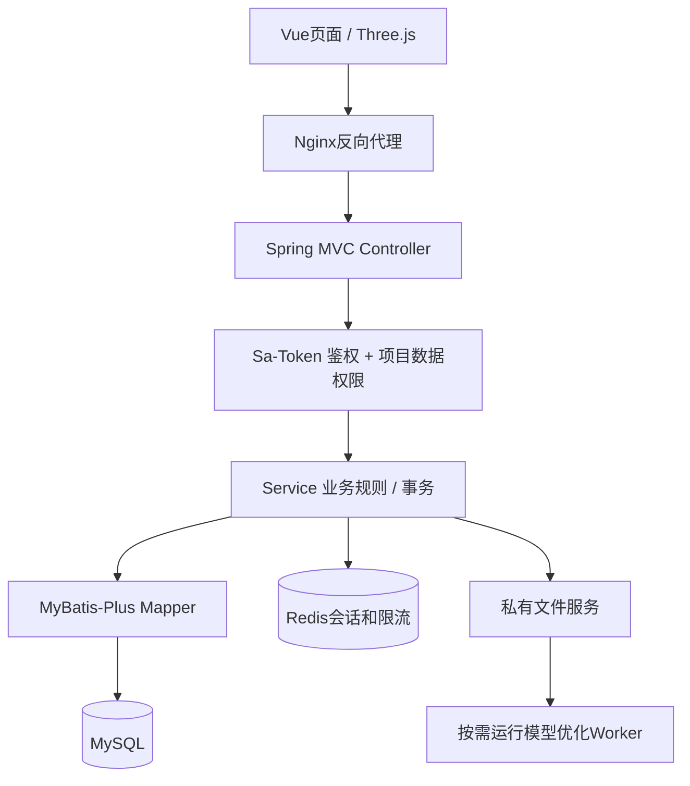

# 经纬空间 · 经纬孪生（Jingwei Spatial Twin）— 完整产品需求、技术架构、开发规约与AI协作手册

> 文档名称：`JINGWEI_SPATIAL_TWIN_MASTER_PLAN.md`  
> 推荐项目根目录：`jingwei-spatial-twin/`  
> 简称：`JWST`（仅内部代号，注意避免与其他广泛使用的英文缩写混淆）  
> 版本：`V1.0 规划基线`；编制日期：2026-10-13  
> 阶段：个人非商业开发、开源优先、预留未来合规商业化能力  
> 交付目标：可运行的前后端系统 + 交互式管理后台 + 三维地图编辑器 + 资料接入 + 最小安全基线

## 0. 阅读导航与交付物

- 本文档是**产品和研发总纲**，不是声称系统已经完成开发。
- 同目录的 `jingwei-ui-prototype.html` 是**独立可打开的中文交互页面原型**，采用模拟数据；不是真实高德地图或Three.js渲染。
- 一次性实现所有功能不适合个人开发者；通过 `M0～M7` 逐阶段交付。
- 相关规范：国家现行 `GB/T 22239-2019` 等保基本要求；当前只能称为“**按三级等保目标设计**”，不能宣称已取得三级等保测评结果；最终需要系统定级、备案、整改、测评、运营制度和基础设施保障。

## 1. 项目名称、定位与原则

**中文名**：经纬空间 · 数字孪生管理平台  
**英文名**：Jingwei Spatial Twin  
**仓库**：`jingwei-spatial-twin`  
**Maven groupId**：`com.jingwei.spatial`  
**Java包名**：`com.jingwei.spatial`  
**前端包名**：`spatial-twin-web-admin`  
**数据库名**：`jingwei_spatial`  
**接口前缀**：`/api/v1`  
**表前缀**：`jw_`  
**本地开发域名/端口**：`http://localhost:5173`（Vue）、`http://localhost:8080`（Spring Boot）  
**产品Slogan**：*选定空间，连接真实。*

**核心定位**：面向园区、楼宇、物业、工厂和后期其他场景的轻量级、写实、可编辑空间数字孪生平台；用户通过高德地图定位/标注自己的空间对象，按需管理高品质楼宇、楼层、图纸、设施和业务数据。

### 1.1 核心不可妥协原则
1. **经纬地图底座是全项目核心基础**：首页、园区、楼宇、楼层、设备、资产和发布场景都必须建立在统一空间底座与坐标体系上；不得把地图降级为某个孤立页面或仅用于选点的第三方控件。
2. **写实优先，不能把低模方盒子当作最终演示效果**：默认园区也有合理建筑立面、光影和绿化；低模只作为远景与过渡。
3. **只精细化用户标注且选择的对象**：默认地图轻量；地图拖动时请求可见区域索引；点击楼宇仅显示摘要，进入精细模式才加载高清楼宇；楼层/管线进一步按需加载。
4. **模型与业务对象分离**：建筑、楼层、空间、设备ID不依赖GLB节点；楼宇替换时进行关系迁移和冲突提示。
5. **客户资料优先**：图片、PDF、GLB、CSV优先支持；DXF/IFC/正射影像/3D Tiles逐期接入，保留原文件、版本和来源。
6. **低成本 + 客户端渲染**：三维GPU工作主要由浏览器承担；Java服务提供数据、鉴权和资源；重转换工作离线按任务执行。
7. **按三级等保目标预设计**：认证、权限、操作日志、数据保护、上传安全、备份、分级授权都不能在后期硬补。
8. **不要为了“先进”堆技术**：单体模块化MVC；不建微服务、不强行引入Cesium、K8s、Kafka等。
9. **所有业务代码与配置采用中文说明**：标识符用清晰英文，注释、API描述、操作说明中文，错误提示中文。

### 1.2 明确不做（MVP）
不做完整BIM构件编辑器、不做CAD制图软件、不做自动真实建筑重建、不做整座城市倾斜摄影、不做人员实名实时追踪、不做对外商业SaaS计费、不做多人实时协作、不做云端像素流送、不做未经确认的消防疏散线路自动推断。

### 1.3 目标用户和权限
首批场景：个人管理员；第二批：园区系统集成商、物业运营者；远期：工厂、家庭、政府场景（需要独立应用模板及合规适配）。
角色：超级管理员、项目管理员、空间编辑员、资料管理员、运营查看员、审计员；角色可自定义，权限按菜单、按钮、API和项目/空间对象四层实施。


## 2. 功能地图与优先级

| 编号 | 模块 | 核心功能 | MVP | 后续 |
|---|---|---|---|---|
| SYS | 系统管理 | 注册开关、登录登出、账户、组织、角色权限、菜单、审计、安全策略 | M1 | 多租户/SSO |
| PRJ | 项目管理 | 项目创建、默认地图视角、发布版本、导入导出、封面、归档 | M2 | 快照比较 |
| MAP | 地图与标注 | 高德2D/3D、地点搜索、默认区域、区域圈选、点线面标注、楼宇轮廓 | M2 | 多底图 |
| BLD | 建筑编辑 | 写实模板、创建/移动/旋转/缩放、模型替换、GLB、楼层目录 | M3 | 参数化幕墙 |
| FLR | 楼层空间 | 平面图上传、图纸配准、房间区域绘制、楼层过滤、楼层堆叠 | M4 | IFC空间提取 |
| AST | 资产管理 | 模型、图纸、材质、来源、授权、哈希、版本、优化状态 | M3 | BIM/CAD |
| EQP | 设备与组织 | 摄像头/消防/设备标注，部门/人员数量，点位归属 | M4 | IoT联动 |
| LYR | 专业图层 | 管线、消防设施、疏散路线、区域可见性、访问控制 | M4基础 | 工程审核 |
| PERF | 加载调度 | 视野内索引、精细手动加载、资源预算、资源卸载、诊断 | M3 | Tiles调度 |
| PUB | 草稿与发布 | 草稿、校验、预览、发布、回滚、版本备注 | M4基础 | 审批流 |
| OPS | 运维与安全 | 日志、监控、备份、导入限额、用户锁定、配置 | M1基础 | 等保测评配合 |

### 2.1 用户故事（必须跑通）
- **US-001** 首次访问出现中文登录页；管理员登录后进入经纬空间总览地图，在地图上查看其有权限访问的全部园区项目；未登录不得读取项目位置、私有模型和空间摘要。
- **US-002** 管理员新建“示范园区”，保存默认高德中心点/缩放/俯仰角，后续每次打开即进入该区域。
- **US-003** 地图上绘制园区多边形、楼宇轮廓；标注对象入库；没有被标注的区域不加载自建高清三维资源。
- **US-004** 为已标注楼宇选择漂亮的写实模板，配置位置、方向、尺寸和层数，默认显示标准版本。
- **US-005** 点击楼宇即显示摘要；按“进入精细视图”才加载高精GLB；旧资源加载失败不丢失原状态。
- **US-006** 通过模型上传替换外观，建筑业务ID不变；发现楼层差异时提示映射与待处理关系。
- **US-007** 选择6楼，上传平面PDF/PNG，在楼层上描绘房间与部门区域，放置摄像头，绘制经确认的疏散线。
- **US-008** 退出精细视图时卸载不再用的几何与纹理；切换多个楼后资源占用趋于稳定。
- **US-009** 切换普通查看账号，不能进入编辑器，不能下载未授权管线/安防文件，后端须校验。
- **US-010** 导出项目清单/资源包，重新导入后空间对象与资源关联可恢复。

### 2.2 业务流程



## 3. 技术基线（不要自行乱换栈）

| 部分 | 技术 | 用途与取舍 |
|---|---|---|
| 前端 | Vue 3 + TypeScript + Vite + Vue Router + Pinia | 中文后台、编辑器状态，Three对象不纳入深层响应式 |
| UI | Element Plus + CSS变量 + Lucide图标 | 后台组件、表单、弹窗、通知、暗亮主题 |
| 地图 | 高德 JS API 2.0 | 道路、地址搜索、点线面绘制；遵守个人非商用条款；必须隔离MapAdapter |
| Web 3D | Three.js WebGLRenderer | 写实GLB、PBR、模型选取、TransformControls、楼宇编辑 |
| BIM扩展 | That Open Components/Fragments + web-ifc | 仅在阶段需要时引入；核实版本兼容与授权 |
| 大场景扩展 | CesiumJS/3DTilesRendererJS | 可选，不与高德和Three完整3D常驻同时运行 |
| 后端 | **JDK 21 + Spring Boot 3.x + Spring MVC** | Controller-Service-Mapper三层；不混用Spring Boot 4 starter |
| 鉴权 | **Sa-Token Spring Boot 3 starter** | 登录/角色/权限/会话；必须配置全局拦截/异常处理 |
| ORM | **MyBatis-Plus Spring Boot 3 starter** | CRUD，XML写复杂SQL；可选分页/防全表更新插件 |
| DB | **MySQL 8.x** | 业务实体和空间索引；geometry保存SRID/坐标元数据；Flyway迁移 |
| Cache | **Redis** | Sa-Token会话、验证码/限流、热点索引缓存；不是持久化主库 |
| 工具 | **Hutool（限制用途）** | 字符串、时间、摘要等便捷功能；安全和密码算法用专用实现 |
| 参数校验 | Jakarta Bean Validation | DTO字段和服务边界校验 |
| 接口文档 | springdoc-openapi（与Boot版本兼容） | Swagger UI仅开发环境或受限管理员使用 |
| 日志 | SLF4J + Logback | JSON化审计可选，严格脱敏 |
| 迁移 | Flyway | SQL版本化，不允许线上手动改表后不留记录 |
| 对象文件 | MinIO | 私有桶 `spatial-twin`；数据库仅保存对象键，文件访问统一经过权限校验 |
| 模型制作 | Blender | 生产写实模型资产，不向普通客户暴露建模软件 |
| 模型优化 | glTF Transform / Meshoptimizer / KTX2 | 上传后离线任务；保留原件和轻量/高清两个发布变体 |
| 部署 | Maven + pnpm + Docker Compose | 单体部署、MySQL、Redis；Nginx反向代理；可纯本地开发 |
| 测试 | JUnit 5、Spring Boot Test、Vitest、Playwright | 只运行改动相关的最小验证集 |

**选型冻结规则**：首期固定Spring Boot 3.x、JDK21、对应的 `sa-token-spring-boot3-starter` 与 `mybatis-plus-spring-boot3-starter`；生成工程前以官方兼容矩阵确定确切小版本并锁在pom和lockfile里，不能随意填“latest”。MyBatis-Plus 3.5.9+ 的插件依赖需显式处理。

**关于MVC**：REST后端使用 Spring MVC：Controller负责请求/响应与校验、Service负责事务和业务规则、Mapper负责持久化；DTO/VO/Entity分层。前端使用组件与状态管理，不强行套Java服务器模板式MVC。

**Redis用途**：既然你希望采用Redis，初版保留它用于登录会话与简单限流；在本地单人模式可配置Redis不可用时禁止启动鉴权服务，而不是静默退化为不安全状态。生产不得将Redis直接暴露公网。

### 3.1 经纬地图底座（全项目核心基础）

**架构决策 JW-MAP-001**：经纬空间不是“管理后台中嵌入一张地图”，而是以统一地图底座组织全部空间业务。项目、园区、楼宇、楼层、空间、设备、专业图层、资产绑定和发布版本，都必须能够回到同一套空间坐标、对象标识、可见级别和加载协议中。首页空间总览、园区编辑器与楼宇精细模式是同一空间体系的不同观察尺度，不得各自维护互不兼容的地图状态。

#### 3.1.1 底座分层

| 层级 | 职责 | 强制边界 |
|---|---|---|
| 地图供应商适配层 | 通过`MapAdapter`提供底图、坐标转换、相机、搜索、事件和点线面绘制 | 页面和业务组件不得直接调用高德全局对象；未来可接入合规离线底图或其他供应商 |
| 经纬视觉底座层 | 定义道路弱化、地貌水系、行政边界、背景、光照、雾效、选中态、聚合点、园区边界和品牌标识 | 不是简单更换高德主题色；样式需版本化、可配置，并在总览与编辑场景保持一致 |
| 空间业务索引层 | 按权限、bbox、缩放级别返回项目、园区、楼宇和图层的轻量描述 | 不返回无权限项目；不在总览接口泄露私有模型地址、内部文件路径和敏感工程属性 |
| 三维场景层 | 通过Three.js渲染园区环境、标准楼宇和被选中的精细楼宇 | 远景不加载精细模型；Three对象由场景管理器持有并负责完整释放 |
| 交互与状态层 | 统一管理相机、当前项目、选中对象、图层开关、加载状态和场景跳转 | 首页、园区编辑器、楼宇精细模式使用兼容的场景状态协议，不重复创造坐标与选中状态 |

#### 3.1.2 首页空间总览定位

- `/dashboard`默认呈现可操作的全屏经纬空间总览地图，不以传统统计卡片作为第一视觉主体。
- 总览地图展示当前用户有权限访问的全部园区项目；跨城市或大范围视角使用聚合点和轻量摘要，禁止一次加载全部园区模型。
- 点击项目先显示名称、位置、状态、建筑数量、当前发布版本、更新时间和封面摘要，再由用户主动进入园区。
- 没有项目时，地图仍正常展示，并提供“创建园区项目”入口和明确空状态；地图供应商不可用时显示可恢复的降级底座与项目列表，不允许整个首页白屏。
- 项目、发布、告警、导入任务等统计信息作为地图的辅助信息带或可收起面板存在，不遮挡主要空间画面。

#### 3.1.3 连续空间层级与加载规则

`全国/跨城市项目聚合 → 城市项目点位 → 园区边界与摘要 → 园区标准场景 → 楼宇标准模型 → 单栋楼精细模型 → 单楼层与专业图层`

- 缩放和场景跳转必须保持连续感，不把每一级做成互不关联的独立页面。
- 项目总览级只请求授权项目的轻量位置和摘要；进入可视范围后才请求园区边界与标准场景清单。
- 园区级按bbox加载空间要素和标准模型；点击楼宇立即返回轻量摘要，进入精细模式后才请求`DETAIL`资源。
- 楼层、房间、设备、管线和专业资料只有在用户进入对应对象、开启图层且具备权限时才请求。
- 视图移动、层级切换和路由跳转必须取消过期请求，并保留可复用的轻量缓存，避免重复下载和资源泄漏。

#### 3.1.4 经纬视觉语言

- 地图视觉应突出用户自己的园区和楼宇，基础道路、通用POI和行政文字降低对比度，但仍保持辨识与可用。
- 园区边界、楼宇轮廓、聚合点、选中态、发布状态和异常状态使用统一的颜色、线型、材质与动效语义。
- 不以常见“深色科技大屏、满屏发光点、低模方盒”代替产品特色；特色来自空间层级、写实模型、克制的信息表达和稳定交互。
- 地图主题必须提供亮色默认主题，并预留独立深色主题；业务状态不能只依赖颜色表达。
- 项目封面、园区预览和发布快照优先从同一场景与视觉配置生成，确保管理页面与地图场景视觉一致。

#### 3.1.5 后续功能依赖规则

- 新增任何园区、楼宇、楼层、空间、设备或专业图层功能时，必须说明对象如何定位、在哪个缩放/场景级别出现、由哪个接口加载、使用何种权限以及退出后如何释放。
- 能够空间化的业务对象必须关联稳定业务ID、`projectId`和明确坐标参考系；禁止只依赖模型节点名、文件名或页面临时坐标。
- 地图供应商Key、样式标识和服务地址只能通过受控配置注入，不得写死在Vue页面。
- 经纬视觉底座配置要有版本概念；已发布项目应能够追溯当时使用的底座配置，升级主题不得破坏项目空间数据。
- 高德负责合规的基础地理能力，经纬空间负责业务空间表达和三维场景；不得擅自抓取、下载或重新托管高德底图数据。


## 4. 完整目录和命名规范

```text
jingwei-spatial-twin/
├── README.md                           # 中文项目介绍与启动步骤
├── JINGWEI_SPATIAL_TWIN_MASTER_PLAN.md # 本开发总纲
├── AGENTS.md                           # AI协作开发约束
├── .editorconfig
├── .gitignore
├── docs/
│   ├── 00-overview/                    # 项目定位与里程碑
│   ├── 01-requirements/                # 需求与验收案例
│   ├── 02-design/                      # UI原型、交互、设计令牌
│   ├── 03-architecture/                # C4图、ADR、数据流、坐标规范
│   ├── 04-database/                    # ER图、字段字典、索引计划
│   ├── 05-api/                         # API约定、OpenAPI快照
│   ├── 06-security/                    # 等保对照、威胁建模、应急预案
│   ├── 07-performance/                 # 预算、基准、profiling记录
│   ├── 08-assets/                      # 资产规范、模型质量要求
│   └── 09-operations/                  # 部署、备份、恢复、巡检
├── spatial-twin-web-admin/
│   ├── public/
│   ├── src/
│   │   ├── main.ts
│   │   ├── App.vue
│   │   ├── router/index.ts
│   │   ├── stores/{auth,project,editor,layer}.ts
│   │   ├── api/{auth,system,project,map,building,floor,asset,device}.ts
│   │   ├── layouts/{AuthLayout,AdminLayout,EditorLayout}.vue
│   │   ├── views/
│   │   │   ├── auth/{LoginView,RegisterView}.vue
│   │   │   ├── dashboard/DashboardView.vue
│   │   │   ├── project/{ProjectListView,ProjectDetailView}.vue
│   │   │   ├── editor/{SpatialWorkspaceView,BuildingEditorView}.vue
│   │   │   ├── floor/FloorWorkspaceView.vue
│   │   │   ├── asset/{AssetListView,ImportWizardView}.vue
│   │   │   ├── system/{UserView,RoleView,MenuView,AuditView,SettingsView}.vue
│   │   │   └── error/{ForbiddenView,NotFoundView}.vue
│   │   ├── components/{common,map,scene,building,floor,asset,security}/
│   │   ├── core/{map,scene,editor,streaming,loaders,types}/
│   │   ├── styles/{tokens,base,editor}.css
│   │   └── utils/{request,error,format,guard}.ts
│   ├── package.json
│   ├── tsconfig.json
│   └── vite.config.ts
├── spatial-twin-java/
│   ├── pom.xml                         # Maven 聚合工程
│   ├── spatial-twin-common/            # 统一响应、异常和请求上下文
│   ├── spatial-twin-module-system/     # 认证、用户、角色、菜单、配置和审计
│   └── spatial-twin-server/            # 启动、配置和业务模块装配
│       └── src/main/
│           ├── java/com/jingwei/spatial/SpatialApplication.java
│           └── resources/
│               ├── application.yml
│               ├── application-dev.yml
│               ├── application-prod.yml
│               └── mapper/             # 业务查询 XML
├── db/
│   ├── README.md
│   └── migration/                      # 仅数据库结构和必要基础数据变更
│       └── V1__initialize_rbac.sql
├── tools/
│   └── asset-worker/                   # Node CLI（非常驻服务）
│       ├── package.json
│       ├── scripts/{inspect,optimize,manifest}.mjs
│       └── README.md
├── assets/
│   ├── original/                       # 自有原始模板，不直接对外展示
│   ├── published/{standard,detail}/    # 两种发布资产变体
│   └── licenses/                       # 资产来源/许可证明
├── storage/                            # 本地开发数据，git忽略
├── deployment/{docker,nginx,backup}/
├── prototypes/jingwei-ui-prototype.html
└── scripts/{dev,check,backup}/
```

**目录硬约束**：

1. 一级工程目录固定使用 `spatial-twin-web-admin`、`spatial-twin-java` 和 `db`，不得创建带品牌拼音前缀的重复工程目录，也不得使用含义过泛的 `server`、`app` 作为一级工程名。
2. `db/migration` 只保存表、字段、索引、约束及必要基础数据的版本化变更 SQL；业务查询、分页筛选、联表和报表 SQL 必须放入所属后端模块的 Mapper Java/XML。
3. 添加或修改功能时，凡涉及前后端契约、数据或操作的对应变化，必须同轮完成前端与后端修改和最小验证，不允许只完成单侧后结束交付。
4. 每轮问答和执行前必须先阅读根目录 `AGENTS.md`，并复核本文档当前任务相关章节。

**命名规范**：Java类PascalCase，方法/字段camelCase；前端组件PascalCase、组合函数useXxx、文件API小写；DB表 `jw_模块_实体`，列snake_case；权限码 `模块:对象:动作`（如`building:edit`）；事件`jw.spatial.building.updated`；模型文件`{buildingId}_{variant}_{version}.glb`；日志必须记录requestId和objectId。


## 5. 后端架构和完整MVC责任划分



### 5.1 各层规约
- `Controller`：不写业务SQL和长事务；使用 `@Validated`、权限注解、统一返回 `ApiResponse<T>`、统一异常映射。
- `Service`：处理建筑模型替换/楼层映射/发布/版本/文件事务；跨文件与DB操作用状态机和补偿，不假设数据库事务覆盖文件系统。
- `Mapper`：MyBatis-Plus基础CRUD；复杂查询使用参数绑定XML；不得拼接用户提供的列名、排序SQL。
- `Entity`：DB实体不直接向客户端输出，避免密码哈希、密钥、内部路径泄露。
- `DTO`：创建/修改/查询分别定义，使用分组校验或独立DTO。
- `VO`：输出最少需要的字段；公开地图只返回可见资源的描述信息。
- `Security`：登录身份与角色权限之外，**每次**按项目归属/对象范围做数据权限校验。越权返回403或不透露存在性的404。
- `Audit`：用户、动作、目标、项目、结果、IP/UA、时间、requestId；不记录令牌和密码。

### 5.2 典型后台模块/接口清单（初期）
| 接口 | 方法 | 用途 | 权限 |
|---|---|---|---|
| `/api/v1/auth/register` | POST | 受开关约束注册 | 公共+限流 |
| `/api/v1/auth/login` | POST | 密码登录 | 公共+限流 |
| `/api/v1/auth/logout` | POST | 撤销当前会话 | 登录 |
| `/api/v1/auth/me` | GET | 当前用户与权限集 | 登录 |
| `/api/v1/auth/password` | PUT | 更换密码 | 登录/二次验证 |
| `/api/v1/system/users` | GET/POST | 用户管理 | `system:user:list/add` |
| `/api/v1/system/users/{id}` | PUT/DELETE | 状态更新/逻辑删除 | `system:user:edit/delete` |
| `/api/v1/system/roles` | GET/POST | 角色权限 | `system:role:*` |
| `/api/v1/system/menus` | GET | 后台菜单树 | 登录 |
| `/api/v1/system/audits` | GET | 审计检索 | `system:audit:list` |
| `/api/v1/projects` | GET/POST | 项目列表/创建 | `project:*` + 项目归属 |
| `/api/v1/spatial/overview` | GET | 按bbox、缩放级别返回有权限项目的聚合点或轻量空间摘要 | 登录 + 项目数据范围 |
| `/api/v1/projects/{id}/startup` | GET/PUT | 默认视角/可见图层 | 项目访问/编辑 |
| `/api/v1/projects/{id}/features` | GET | bbox范围标注索引 | 项目访问 |
| `/api/v1/spatial/features` | POST/PUT/DELETE | 点线面标注 | `spatial:edit` |
| `/api/v1/buildings` | POST | 新建建筑 | `building:add` |
| `/api/v1/buildings/{id}` | GET/PUT | 建筑摘要/修改 | `building:view/edit` |
| `/api/v1/buildings/{id}/manifest` | GET | 模型资源清单，不返回原始私有路径 | 目标楼宇权限 |
| `/api/v1/buildings/{id}/replacements` | POST | 创建替换草稿与映射计划 | `building:replace` |
| `/api/v1/buildings/{id}/detail-session` | POST | 检查访问权，获得短期精细资源访问能力 | `building:detail` |
| `/api/v1/floors/{id}` | GET/PUT | 楼层信息 | `floor:view/edit` |
| `/api/v1/floors/{id}/spaces` | GET/POST | 房间/区域 | `floor:space:*` |
| `/api/v1/assets/uploads` | POST | 上传任务登记/受控上传 | `asset:upload` |
| `/api/v1/assets/{id}` | GET | 资产详情与处理状态 | `asset:view` |
| `/api/v1/assets/{id}/download` | GET | 鉴权后下载/签名URL | 资产范围 |
| `/api/v1/releases` | POST | 草稿发布 | `project:publish` |
| `/api/v1/health` | GET | 最小健康探针 | 控制返回信息 |

**返回结构**：`{code, message, data, requestId, timestamp}`，HTTP状态码保持语义；前端拦截器按401/403/409/422/429/5xx处理。分页统一`pageNo,pageSize,total,records`，限制最大pageSize，限制bbox面积和单次要素数。

### 5.3 登录与注册流程
1. `registerEnabled` 默认false；首次安装只允许初始化向导设置管理员，不在公开接口创建默认弱口令。
2. 密码使用成熟的自适应密码哈希实现（Argon2id，或合规环境下经批准的PBKDF2等方案）；**不使用Hutool MD5/SHA-256直接存密码**。
3. 登录限速按账号+IP组合；失败阈值触发短期锁定/人工验证；避免暴露账号是否存在。
4. Sa-Token生成会话，令牌走经审查的安全Cookie策略或安全Header；禁止URL参数和localStorage持久存高敏感长期令牌。若使用Cookie必须完善CSRF防护。
5. 权限既检查接口又检查对象归属；前端按钮隐藏只是UX，不是安全控制。
6. 更改密码、登出所有设备、停用用户时令牌应失效，Redis会话TTL明确。
7. 必须支持管理员二次认证/MFA规划；对标三级要求时完善认证强度、审计和失败保护。

### 5.4 Sa-Token关键落地
- Boot3使用匹配starter；全局注册SaInterceptor开启注解鉴权。
- `StpInterface` 根据用户-角色-权限关联返回权限列表，缓存失效策略清楚。
- 资源级权限在Service显式校验；`@SaCheckPermission` 不能替代对象级权限。
- Redis只作会话/短期缓存，不是用户主数据源。
- 统一处理未登录、无权限、账号封禁、被踢、会话过期等异常，输出中文可理解提示。


## 6. 数据模型与数据库表设计（概念初稿）

### 6.1 通用字段规范
所有业务表（除明确的纯关联表）统一包括：`id BIGINT`（雪花ID或受控生成器）、`created_at DATETIME(3)`、`updated_at DATETIME(3)`、`created_by`、`updated_by`、`deleted TINYINT`、`version INT`。资源文件使用UUID或SHA-256内容标识，不直接用用户文件名做存储路径。字符集`utf8mb4`。每个外键关系建立索引；高频业务查询建立复合索引，禁止无依据地给每列加索引。

### 6.2 系统表
| 表名 | 核心字段（除通用字段） | 索引/约束 |
|---|---|---|
| `jw_sys_user` | username,password_hash,nickname,mobile_masked,status,last_login_at,password_changed_at | username唯一 |
| `jw_sys_role` | code,name,status,description | code唯一 |
| `jw_sys_permission` | code,name,resource_type,description | code唯一 |
| `jw_sys_user_role` | user_id,role_id | 组合唯一 |
| `jw_sys_role_permission` | role_id,permission_id | 组合唯一 |
| `jw_sys_menu` | parent_id,name,path,component,sort_order,permission_code,visible | parent_id,sort_order |
| `jw_sys_setting` | setting_key,setting_value,value_type,is_sensitive | setting_key唯一；敏感值禁止明文 |
| `jw_sys_login_log` | user_id,username_snapshot,ip,result,reason,request_id,occurred_at | 时间、user_id |
| `jw_sys_audit_log` | user_id,project_id,object_type,object_id,action,result,request_id,ip,occurred_at,details_masked | 项目、时间 |

### 6.3 项目、空间与地图表
| 表名 | 核心字段 | 约束/说明 |
|---|---|---|
| `jw_project` | name,owner_user_id,description,status,cover_asset_id,current_release_id | owner+status |
| `jw_project_member` | project_id,user_id,project_role | project+user唯一 |
| `jw_map_base_profile` | profile_code,name,map_provider,style_json,scene_json,version_no,status | 平台级经纬底座视觉配置；profile_code+version_no唯一 |
| `jw_project_view` | project_id,center_lng,center_lat,zoom,pitch,bearing,visible_layers_json,map_provider,base_profile_id | 项目唯一；关联已发布的底座配置版本 |
| `jw_spatial_feature` | project_id,feature_type,name,geometry_json,srid,properties_json,display_level,status,bbox_minx... | project+type；bbox索引 |
| `jw_spatial_relation` | project_id,source_type,source_id,relation_type,target_type,target_id | 关系查询 |
| `jw_scene_draft` | project_id,editor_user_id,base_release_id,revision,content_json | project+revision |
| `jw_scene_release` | project_id,version_tag,manifest_asset_id,published_by,published_at,remark | project+tag唯一 |

### 6.4 建筑、楼层、区域
| 表名 | 核心字段 | 特别约束 |
|---|---|---|
| `jw_building` | project_id,feature_id,name,code,longitude,latitude,altitude,rotation,template_type,current_model_version_id,status | project+code唯一 |
| `jw_building_model_version` | building_id,source_asset_id,standard_asset_id,detail_asset_id,version_no,model_type,manifest_json,status | building+version_no唯一 |
| `jw_floor` | building_id,floor_code,ordinal_no,elevation,height,name,status | building+floor_code唯一 |
| `jw_space` | floor_id,space_code,name,space_type,geometry_local_json,area_m2,status | floor+space_code唯一 |
| `jw_floor_plan` | floor_id,asset_id,transform_json,source_type,version_no,review_status | floor+version |
| `jw_model_node_binding` | model_version_id,node_path,object_type,object_id,confidence,review_state | model+node_path |
| `jw_model_replacement_job` | building_id,old_version_id,new_version_id,mapping_plan_json,conflict_json,status | 状态机 |
| `jw_space_organization` | space_id,org_unit_id,headcount,valid_from,valid_to | 注意统计口径和时间版本 |
| `jw_org_unit` | project_id,parent_id,name,code | project+code |

### 6.5 资源、设备、管线
| 表名 | 核心字段 | 安全和数据要求 |
|---|---|---|
| `jw_asset` | original_name,mime_type,file_size,sha256,storage_key,asset_type,license_info,classification,owner_user_id | 权限+文件安全扫描 |
| `jw_asset_variant` | asset_id,variant_type,storage_key,byte_size,geometry_count,texture_estimate,processing_status | standard/detail/preview |
| `jw_asset_process_task` | asset_id,task_type,status,progress,worker_log_ref,error_code | 任务隔离和超时 |
| `jw_device` | project_id,building_id,floor_id,space_id,device_code,device_type,position_json,status | project+device_code唯一 |
| `jw_layer` | project_id,layer_type,name,visibility_default,classification,style_json | 跨项目隔离 |
| `jw_layer_feature` | layer_id,feature_type,geometry_json,properties_json,source_asset_id,verification_status | 专业资料来源可追溯 |
| `jw_document_revision` | object_type,object_id,asset_id,version_no,approved_by,approved_at,source_date | 有效日期与审核来源 |
| `jw_export_task` | project_id,requested_by,status,output_asset_id,expires_at | 导出受控 |

### 6.6 必须明确的空间约定
- 高德显示坐标与测绘工程坐标、BIM局部坐标不可以互相冒充；明确WGS84/CGCS2000/GCJ-02数据源，合法转换并记录精度。
- MySQL数据库存一份**明确坐标参考系**的规范位置，提供高德显示适配；每个模型保存`localToWorld`变换矩阵或平移/旋转/缩放参数。
- 平面图必须记录配准点、比例、旋转、坐标系、校准人；仅图片不意味着已知准确米制尺寸。
- 建筑/楼层/房间ID恒定；GLB文件名和node.name均不是主键。
- 数据来源和可信度：`TEMPLATE`示意、`DRAWING`设计、`AS_BUILT`竣工、`SURVEYED`测绘、`VERIFIED`已核验；状态不等于自动具有法律工程效力。
- 逃生路线只能展示经核验的线路，不由AI或地图最短路径算法直接生成可执行疏散指引。


## 7. 模型与资料生命周期设计

### 7.1 上传流程
`选择文件 → 前端大小/类型初检 → 后端扩展名与真实格式校验 → 隔离存储原文件 → 建任务 → 扫描/解析元信息 → 生成预览与优化发布变体 → 绑定空间对象 → 人工确认 → 发布`。

允许列表第一阶段：GLB/glTF（注意外链资源和包安全）、PNG/JPEG/WebP、PDF、CSV/JSON；后续DXF、IFC、GeoTIFF等。不要运行任何上传文件里的脚本，不信任GLTF扩展引用路径；检查压缩炸弹、超大纹理、极高面数、三维资产依赖外部URL等情况；每种格式限制体积和处理时间。

### 7.2 双层模型资源
- 标准变体`STANDARD`：园区视野内展示，尽量以中等规模GLB、共享PBR材质和压缩纹理呈现；不是粗劣盒子。
- 精细变体`DETAIL`：只在选择楼宇并开启精细模式后加载；外观和必要几何更细。
- 楼层包`FLOOR_{floorId}`：被选楼层的空间布局/图纸/设备数据单独请求。
- 专业包`DISCIPLINE_{type}`：管线、安防、消防等按图层开关和权限请求。
- 原始资产`ORIGINAL`：用于重新处理/版本追踪，不直接默认分发给所有浏览器。

### 7.3 整栋楼替换（关键设计）
状态机：`UPLOADED → PROCESSING → PREVIEW_READY → MAPPING_REQUIRED → VALIDATED → PUBLISHED`；失败进入`FAILED`且旧版可继续工作。
1. 选择目标楼宇，不新建业务建筑ID。
2. 上传或选择新模型，做结构/比例/坐标校准。
3. 建议楼层映射：编号、标高、IFC空间信息；必须允许人工改正。
4. 对删除/新增楼层和房间生成影响报告：设备悬空、部门空间失效、图纸失效、绑定节点失效。
5. 预览变化和当前资源估算；发布时原子更新版本指针；保留回退版本。
6. 不自动删除失配设备与部门数据，标记`UNRESOLVED`待处理。

### 7.4 性能与模型质量门槛
导入检查：三角面数、DrawCall估算、纹理最大尺寸、纹理数、未引用资源、重复几何、潜在非流形问题、模型包围盒、缺失楼层层级、压缩状态。超预算允许原件入库但阻止直接作为默认轻量展示资源。压缩减少传输大小不等于降低全部GPU负担；需测实际渲染指标。

### 7.5 文件存储策略
统一使用 MinIO 私有对象存储，默认桶为 `spatial-twin`，对象键按 `{业务类型}/{projectId}/{sha256-prefix}/{uuid}` 组织；DB只保存storageKey，不保存本机绝对路径和永久公开地址。受控文件服务必须验证项目与资源权限，再通过后端流式响应或短时效预签名地址提供下载，并支持HTTP Range和合理缓存语义。大文件使用分块上传/恢复（后期）。原文件、轻量/精细发布文件分开生命周期，清理任务先检查引用计数、版本回滚需要与导出依赖。MinIO endpoint、access key、secret key 必须由私有YAML或环境变量注入，生产桶保持私有且使用最小权限账号。


## 8. 客户端加载、显存与低内存设计

### 8.1 用户已确认的加载规则（不得擅自改变）
1. 每个项目默认中心/缩放/相机/可见图层独立保存；打开只请求初始bbox范围内用户标注要素清单。
2. 未标注区域：高德普通背景；自有高精3D完全不加载。
3. 已标注并进入当前视野：显示标准写实建筑模型；不加载室内与管线。
4. 点击建筑：立即显示楼宇基本信息，不因高清模型下载阻塞交互。
5. 点击“进入精细化”：仅目标楼宇下载`DETAIL`，同一时刻至多一栋楼处于完整精细会话。
6. 楼层单选：只加载该楼层必要结构；摄影/管线等专业图层在用户主动开启后单独请求。
7. 退出/切换：及时卸载无引用高精模型、纹理、后处理目标；标准模型继续展示。
8. 视野移动：保留轻量背景/已加载资源；抑制抖动，取消过时网络任务，等待视图稳定后逐步升级。

### 8.2 调度器优先级
`用户当前精细楼宇 > 当前可视标注对象标准模型 > 新视野边缘标准模型 > 邻近预取 > 非当前楼层 > 历史缓存`。
采用bbox与建筑包围球做粗筛，屏幕投影尺寸决定是否有必要拉取高清资产。不要因鼠标短暂经过就大量加载高精资源。

### 8.3 内存预算（非实测承诺）
| 档位 | 典型设备 | 应用级CPU内存+GPU资源策略 | 帧率目标 |
|---|---|---|---|
| 轻量 | 8GB内存集成显卡 | 少量并行（2）；强缓存上限，优先标准模型；精细单楼 | 常规浏览≥30fps目标 |
| 标准 | 16GB内存 | 3–4并行；较好的阴影和纹理；精细单楼 | 常规浏览45–60fps目标 |
| 高画质 | 16GB+独显 | 4–6并行；高精外观、较大缓存 | 60fps目标（需测试） |

**严禁把“GPU估算字节数”当成浏览器进程准确内存值**。对三角形、纹理宽高、格式、mipmap估算并结合Chrome Performance/Memory/Profile实测。高德自身的WebGL占用不受自研Three资源调度器直接控制。

### 8.4 具体技术细节
- `GLTFLoader + KTX2Loader + MeshoptDecoder`；几何体/纹理共享缓存用引用计数。
- 完整`dispose()`：geometry/material/texture/renderTarget释放 + 引用计数归零；仅隐藏`visible=false`不等于释放。
- 编辑器模式按需暂停园区级高开销3D渲染；避免高德3D、独立Three、Cesium三套大型上下文同时满负荷运行。
- 使用`requestAnimationFrame`按需渲染（静止时减少持续刷新），有动画时恢复；页面隐藏后降频/停止绘制。
- 统一网络并发池、AbortController取消失效请求、错误退避、可见首屏优先。
- IndexedDB可缓存资源描述/少量经授权资源，但不能视为无限容量磁盘；高德底图不得擅自下载托管。
- 浏览器对不同硬件的GPU显存可用量无法可靠精确查询，采用经验预算+运行时反馈自适应。
- 对已选建筑保持较清晰渲染，先降远景精度与阴影而不是让目标建筑变糊。

### 8.5 性能验收案例
- 在同一办公电脑/同一园区上记录冷启动、热启动、第一次进入精细楼宇、重复A↔B楼切换10次后进程内存/纹理对象数量。
- 目标：重复切换后资源数量趋稳，不持续单调上涨；失败资源不拖垮整个地图。
- 冷启动先地图与标注可操作，再补写实建筑；严禁等待整个园区BIM加载完成才显示UI。
- 每次发布模型必须保存文件大小、资源估算、截图、FPS采样、测试机配置和浏览器版本。


## 9. UI系统设计与页面级原型规格

**交互原型**：见同目录 `jingwei-ui-prototype.html`；以下是各页面详规，开发时对照原型的导航、布局、控件、状态和中文提示实现。

### 9.1 视觉风格
- 视觉方向：现代专业工程平台，浅色工作台为默认，深色可选；避免过度科技蓝发光大屏。
- 主色：深海蓝`#244d6f`，强调青`#19a7a0`，警示橙`#ef9b45`，底色`#f3f6fa`；深色主题独立令牌。
- 常用字号：标题20–24、模块标题15–18、正文13–14、辅助12；面板卡片圆角8–12。
- 三维场景尽量无遮挡：编辑工作台左侧240px导航树，右侧300–340px属性面板，顶部56px工具栏，底部26px状态栏；窗口小于1280px右侧收起成抽屉。
- 非编辑模式减少悬浮面板，优先画面。

### 9.2 页面/路由完整列表
| 路由 | 页面 | 主要组件 | 典型操作 |
|---|---|---|---|
| `/login` | 登录 | logo/账号/密码/记住设备/验证码或二次认证/异常提示 | 安全登录 |
| `/register` | 注册（可关闭） | 用户名、邮箱/手机选配、密码规则、协议 | 提交注册 |
| `/dashboard` | 经纬空间总览 | 自有地图底座、项目聚合、园区摘要、辅助统计、快捷入口 | 浏览全部园区/打开项目 |
| `/projects` | 项目管理 | 搜索、卡片表格切换、封面、更新时间、新建 | 创建/筛选/归档 |
| `/projects/:id` | 项目详情 | 名称、默认地图参数、成员、数据统计、最近版本 | 启动项目 |
| `/editor/:id` | 园区地图编辑器 | 高德地图、中部画布、左侧树、右侧属性、底部状态栏 | 圈选、标注、移动、绑定 |
| `/editor/:id/buildings/:bid` | 楼宇精细编辑 | 独立Three画布、楼层选择、模型版本、材质和位置 | 精细加载、模型替换 |
| `/editor/:id/floors/:fid` | 楼层编辑 | 2D平面、导入底图、房间多边形、设备图层 | 描图、标注、保存 |
| `/assets` | 资产中心 | 文件分类、筛选、处理状态、来源许可、版本 | 上传/预览/绑定 |
| `/assets/import` | 资料导入向导 | 选择类型、上传、解析、校准、确认发布 | 完成导入 |
| `/releases` | 场景发布与版本 | 草稿、校验、历史版本、回滚、对比 | 发布场景 |
| `/system/users` | 用户管理 | 表格、角色、状态、锁定、重置操作 | 创建/停用 |
| `/system/roles` | 角色权限 | 角色列表、菜单树、按钮权限、项目作用域 | 分配 |
| `/system/menus` | 菜单配置 | 路由、图标、排序、权限码 | 管理 |
| `/system/audits` | 审计日志 | 筛选、时间、操作对象、结果、详情 | 审计检索 |
| `/system/settings` | 系统设置 | 安全策略、注册开关、地图Key提示、存储限制 | 配置 |
| `/tools/performance` | 性能诊断 | FPS、Draw Call、GPU估算、缓存、当前bbox | 调试 |
| `/403`、`/404` | 错误页 | 中文错误说明和返回 | 安全降级 |

### 9.3 核心页面详规：登录
桌面左右布局；左侧品牌与写实园区视觉插画（不加载真实3D），右侧登录卡片；支持用户名/密码、密码显示按钮、登录中、防重复提交、登录失败提示、账号锁定提示、安全策略提示。注册入口仅在允许注册时出现；默认仅初始化管理员。移动端单列响应。

### 9.4 核心页面详规：工作台
工作台首页即经纬空间总览地图，是平台默认主场景和品牌核心体验。首屏以地图为主体，展示当前用户有权限访问的全部园区项目；跨区域视角显示项目聚合和轻量状态，靠近项目后显示园区边界、名称、建筑数量和发布状态。点击园区显示摘要面板，用户主动确认后进入对应园区默认视角。

最近项目、最近发布版本、导入异常、资源状态和待审核模型放入可收起的辅助区域，不得用大量统计卡片挤压地图。项目预览图从统一场景生成。未建立项目时保留完整地图底座并呈现“创建示范园区”入口；地图加载失败时提供重试、降级底座和项目列表，不能阻断项目访问。

### 9.5 核心页面详规：地图标注工作台
```text
┌──────────────────────────────────────── 顶栏：项目/版本/保存/发布/用户 ─────────────────────────────────────┐
│ 左侧：空间树/搜索         │ 地图/三维画布：高德、用户区域、楼宇、拖拽定位           │ 右侧：属性编辑            │
│ 园区                      │ [搜索位置] [定位] [2D/3D] [标注点/线/面] [撤销]         │ 对象名称、类型、状态       │
│  ├ A栋（写实模板）         │                                                      │ 坐标、轮廓、旋转           │
│  ├ B栋（真实GLB）          │          用户选择的楼宇高亮；非标注区域仅地图背景       │ 标准模型 / 精细模型         │
│  └ C栋（轻量）            │                                                      │ [进入精细视图] [替换]      │
│ 图层                      │                                                      │ 保存草稿/查看变更          │
│  □ 园区边界  □ 建筑       │                                                      │                           │
├───────────────────────────┴──────────────────────────────────────────────────────┴───────────────────────────┤
│ 状态栏：当前坐标 / 缩放级 / 可见建筑数 / 正在加载 / FPS / 资源估算 / 已保存状态                              │
└────────────────────────────────────────────────────────────────────────────────────────────────────────────┘
```
- 绘制模式必须清楚（按钮激活态/ESC退出/右键结束等行为）；未选中对象时显示操作指引。
- 标注后默认标准显示；“允许精细化”是属性开关，“进入精细模式”是主动动作，两者不能混用。
- 楼宇替换走向导：选择资产→模型预览→尺寸坐标→楼层映射→影响评估→确认发布。
- 大地图点击事件不得触发多次重复API；对标注层与背景底图点击优先级做区分。

### 9.6 核心页面详规：楼宇精细模式
顶部显示楼宇名称、所在园区、版本、返回园区；中部独立Three画布；左侧“整体/楼层”树与专业图层；右侧楼宇摘要、模型资源和编辑功能。默认先加载高精外观，楼层目录轻量；点楼层后加载该楼层；机电管线按钮关闭时不应请求管线数据。模式切换动画平滑但可关闭。

### 9.7 核心页面详规：楼层空间编辑
布局：左侧楼层与房间列表，中部二维平面编辑器（可切三维剖切视角），右侧房间/设备详情。工具条：上传底图、标定比例、画房间、点位、折线、测量、图层、撤销、保存。部门面积与人数是业务字段；人数含统计时间和来源。疏散线路需标注“示意/经核验”状态，未核验不能当作现场指引。

### 9.8 核心页面详规：资产导入
4步向导：1文件选择（允许格式、大小、版权确认）；2自动检查（格式/安全/性能）；3校准绑定（选择楼宇与坐标/楼层关系）；4预览确认（标准/精细变体、错误、警告、影响报告）。成功展示可追溯版本，失败保留错误代码与重试入口。

### 9.9 系统管理
用户：姓名/登录名/角色/状态/最后活跃；角色：菜单/接口/对象范围；审计：时间/账号/IP/动作/项目/结果；配置：注册开关、密码策略、会话超时、地图供应商Key、上传限额、存储策略、备份验证。敏感值只可更新不可回显明文。

### 9.10 全局UI状态清单
每个核心页面必须设计：首次空状态、列表空状态、加载中、权限不足、网络异常、资源失败、保存冲突、编辑未保存提醒、删除二次确认、任务完成状态。上传阶段展示进度与当前步骤；地图与模型失败时仍能进入基本信息页。禁用弹窗套弹窗与大量遮挡三维场景的浮层。


## 10. 网络安全等级保护三级目标设计（不能宣称已认证）

现行GB/T 22239-2019为基础依据之一，实际还需核对定级指南、测评要求、密码应用、日志留存、个人信息保护等适用法律、标准和测评机构要求。三级不是“启用Sa-Token”就能完成；包括物理环境、通信网络、区域边界、计算环境、安全管理中心以及管理制度、运维人员、第三方测评等完整体系。个人离线项目并不因写了“等保三级”就自动具备等级保护合规身份。

| 控制方向 | 设计要求 | 软件实现/运营要求 | 验证材料 |
|---|---|---|---|
| 身份鉴别 | 唯一身份、强密码、失败处理、会话超时、重点操作二次认证 | Sa-Token+密码哈希+账号锁定+MFA规划 | 登录测试/配置/审计 |
| 访问控制 | 最小权限、职责分离、对象/项目权限 | RBAC + projectId/spaceId强校验 + 后端下载鉴权 | 越权测试 |
| 安全审计 | 关键行为可追溯、审计数据防篡改 | 登录/授权/导入/下载/发布/删除审计、外部集中留存 | 日志样本和保全方案 |
| 入侵防范 | 最小化暴露、依赖安全、配置加固 | 限流、CSP、上传白名单、漏洞扫描、主机补丁 | 扫描/加固报告 |
| 恶意代码防范 | 上传文件检查、隔离处理 | 文件嗅探、压缩限制、病毒扫描接口、Worker沙箱 | 测试记录 |
| 数据完整性/保密性 | 重要信息保护、加密传输、最少数据 | TLS、敏感字段加密/脱敏、备份加密、权限控制 | 密钥策略/检查 |
| 数据备份恢复 | 定期备份、恢复演练、资源清单一致性 | DB+文件一致性快照、恢复演练、备份隔离 | 演练记录 |
| 安全管理中心 | 集中日志、账号、安全策略、告警 | 管理后台+审计导出、集中监控选项 | 管理制度/记录 |
| 网络和主机 | 边界隔离、最小端口、漏洞修复 | Nginx/TLS、DB/Redis内网、容器非root、安全基线 | 部署与扫描记录 |
| 个人信息与敏感图层 | 目的限制、最小采集、可查询可删除 | 默认只存人数统计，避免无必要实名；图纸与安防受控 | 数据清单/授权记录 |

### 10.1 必须添加的安全检查
- 公开注册默认关闭；首次初始化只允许在本机/安装向导环境执行。
- 密码最少长度、复杂度、锁定阈值、过期策略应可配置，不在代码写死；重要管理员启用强认证。
- 角色-权限设置变更即时生效；前端路由守卫+后端权限注解+Service对象级校验三重防线。
- 文件上传处理与Web请求隔离；上传路径不允许目录穿越，禁止上传HTML/SVG脚本等不受控主动内容直接公开托管。
- 防SQL注入、XSS、CSRF（若用Cookie）、SSRF（外链模型、远端导入）、反序列化和路径穿越；CORS白名单；JSON大小限制。
- 所有敏感工程数据按项目/图层/资产分类，任何直接文件URL都要受限或短时签名，不能公开猜测式访问。
- 日志不含密码、Token、个人身份信息明文、地图服务密钥、敏感模型链接；配置密钥来自环境变量/受保护配置，不能提交Git。
- 非生产默认环境与生产严格隔离；关闭生产Swagger公开访问、异常堆栈和调试端点。
- 建立依赖SBOM与更新流程；安全依赖版本不是盲目升级，升级必须做兼容测试。

### 10.2 建设/运营外部事项
最终若决定对外运营并希望满足三级要求，需要按实际业务办理定级、备案、测评与整改，以及配套物理环境、网络设施、组织制度、人员和安全管理。正式承诺“通过等保三级”必须由对应测评与程序证明，不得在文档或页面虚假声明。


## 11. 中文代码注释和开发规范（提交给ChatGPT的强制约束）

### 11.1 Java
- 类注释说明“用途/范围/关键边界”；`public`业务方法必须中文JavaDoc（业务意图、参数、返回、异常/权限）；复杂逻辑按“为什么这么做”注释，不逐行翻译语法。
- Controller/Service/Mapper/DTO/VO/Entity命名清楚；服务方法优先单一职责；禁止Controller写SQL；禁止为了省事返回Entity。
- 配置`application.yml`、数据库迁移SQL均写中文解释注释，但**真实密钥不写入示例**。
- 异常码由统一枚举管理；所有用户可见错误中文；异常详情进入安全日志，返回端不泄露堆栈。
- 对关键操作（模型替换、楼层映射、发布、权限变更、资产下载）写中文业务设计注释。

### 11.2 Vue/TypeScript
- 每个页面`<script setup lang="ts">`主要功能区中文说明；复杂状态/组合函数写中文JSDoc，公开组件props和事件说明用途。
- TypeScript严禁以大量`any`掩盖接口问题；必须有明确的数据类型和空值分支。
- Vue/Pinia只管理可序列化业务状态；Three.js对象由场景管理层持有并清理。
- 请求层集中处理Token/错误/超时/取消、统一中文提示；不得把URL和Key写死在页面。
- 每个异步过程实现加载态、错误态、取消或重试；组件卸载时清理监听器、WebGL资源引用和下载任务。
- 组件注释主要解释业务意图和交互边界，避免大段无意义重复中文注释。

### 11.3 SQL、YAML与接口注释
- SQL迁移说明表用途和索引含义；表字段`COMMENT`中文；任何删改字段都要有对应迁移。
- YAML采用`application.yml`默认+`application-dev.yml`+`application-prod.yml`，环境密钥读取`${ENV_VAR}`；每个配置块中文注释。
- OpenAPI接口标题、描述、字段说明均中文；权限码英文稳定；错误码可机读。
- 所有时间统一存UTC或明确定义时区；前端转换本地显示，避免日期偏移。

### 11.4 Git与提交
分支：`main`、`develop`、`feat/<topic>`、`fix/<topic>`；提交中文摘要，如`feat(空间): 增加楼宇区域标注接口`。单次任务原则上只改一个子模块，数据库迁移与DTO同步提交，避免无关格式化全仓。


## 12. ChatGPT AI编码协作协议（可复制到仓库AGENTS.md）

> 目标：**少做无关自检，仍要确保尽可能不报错**。任何AI都不能在未运行/未测试的情况下保证代码绝不报错，所以采用“改动范围最小验证”而非每次全仓跑全部测试。

### 12.1 每轮任务固定工作流
1. **读取**：本总纲、当前模块README、相关已有文件与契约；先说明本次任务修改范围。
2. **保留架构**：不得自发换掉Vue/Java/MySQL/Sa-Token/MyBatis-Plus/Redis/Hutool，不得引入微服务或付费SDK。
3. **分小步开发**：每轮完成一个可运行最小闭环（页面、API、SQL与最小验证），不得一次性大规模重写。
4. **写完整文件**：产生能放进项目的完整代码，不输出“此处省略”或伪实现；没有外部依赖时可提供明确Mock开关。
5. **最小检查**：仅检查本轮受影响模块，Java执行编译或相关测试；前端执行`vue-tsc`/构建或受影响测试；接口用最小HTTP案例；3D资源用一个已知可加载测试资产做烟测。
6. **不跑无关项目的重复全量自检**：仅在里程碑（M1/M2/...）或跨模块重构时执行全套检查。
7. **说明结果**：给出修改文件、命令、实际执行结果、尚未验证事项；没有运行的检查必须明说“未执行”，不能写成成功。
8. **处理错误**：发现编译/类型/启动错误，应在当轮范围内修复；若缺SDK Key或外部资源，应有可运行Mock且给出配置办法，不硬编码假数据冒充真实地图。

### 12.2 绝对禁止
- 不得每次回答都自发改变技术架构或新增大型依赖。
- 不得在生产代码写`TODO`占位并宣称功能已实现。
- 不得输出不安全的默认管理员密码或将token/账号密钥写到源码。
- 不得取消后端权限校验来解决403、不得关闭所有CORS/CSRF/上传限制来“保证不报错”。
- 不得把未经校准的模型坐标、消防线路、BIM属性伪装成真实工程数据。
- 不得在未经需求确认时重命名包名/数据库表/路由；需更名先出迁移计划。

### 12.3 单轮验收输出模版
```text
任务：M3-04楼宇GLB模型替换
已完成：文件、API、UI、数据库变更摘要
影响范围：列出路径
检查执行：mvn ... / pnpm ... （实际结果）
未执行：明确理由，例如暂无真实高德Key无法在线集成测试
人工验收：1.打开楼宇；2.上传GLB；3.确认替换；4.退出重开；5.旧关联不丢失
遗留问题：具体问题/风险/解决计划
```

### 12.4 建议按开发阶段启动AI任务
- 第一轮：生成仓库骨架 + Vue管理端布局 + Spring Boot可启动骨架 + MySQL/Redis Docker Compose + 完整中文README。
- 第二轮：Sa-Token注册/登录/登出/权限（同时实现数据库表、初始化管理员向导、审计）。
- 第三轮：项目管理与默认地图配置，先MapAdapter模拟实现，接入高德Key后启用实际地图。
- 第四轮：标注数据CRUD和前端编辑器，bbox范围查询。
- 第五轮：Three.js写实模板场景与模型替换，加入资源清理和性能面板。
- 第六轮：楼层图纸、区域、摄像头与部门数据。
- 第七轮：模型版本与发布、项目导入导出、安全和稳定性。


## 13. 阶段拆解与验收条件

| 阶段 | 交付 | 验收门槛 | 不要提前做 |
|---|---|---|---|
| M0 文档原型 | 仓库骨架、中文页面原型、假数据流程、设计系统 | 关键界面能导航，交互流程无断点 | 真模型转换 |
| M1 安全后端 | Spring MVC、Sa-Token、RBAC、MySQL、Redis、用户/角色/菜单、审计 | 登录/登出/越权/禁用账号通过 | 多租户和SSO |
| M2 地图项目 | 经纬地图底座、MapAdapter、首页项目空间总览、项目默认区域、地图标注、bbox加载 | 首页展示授权项目且不全量加载模型；只返回当前视野标注；重开保持默认视角 | Cesium |
| M3 写实楼宇 | 3种优质模板、标准/高清版本、GLB上传替换、资源释放 | 画质达参考图，A/B切换10次资源趋稳 | BIM编辑 |
| M4 楼层空间 | 楼层、图纸、房间、部门人数、设备点位、图层开关 | 未选楼层不下载详情；关联可保存 | 任意格式自动解析 |
| M5 版本交付 | 草稿/发布/回滚、导入导出、模型质量警告 | 保存发布可回退，跨机器迁移恢复 | 实时协作 |
| M6 工程资料 | IFC、DXF/航拍分步验证、楼层映射和专业图层 | 一个真实资料样本完整导入/校准 | 复杂自动重建 |
| M7 后期 | IoT、更多地图源、私有化完整交付、行业模板 | 真实客户场景/合规审查 | 非必要扩张 |

**建议先做M0-M3作为个人开发核心里程碑**。复杂工程资料要有真实客户数据样本后再启动，否则在缺少输入格式和质量标准时容易白做。

### 13.1 基准测试样板
- 1个虚拟园区，5栋外观写实建筑，2个自定义标注区域。
- A栋标准+高清双版本，B栋上传外部GLB后替换；A栋6层含PDF平面图、房间与摄像头。
- 1个管理员、1个查看员；审计登录、上传、替换和发布。
- 在8GB集成显卡办公机上做实测（记录机型/浏览器/版本），而不是写未经验证的保证数值。

## 14. 开发环境和配置约定

### 14.1 环境
JDK21、Maven3.9+、Node LTS、pnpm、MySQL8、Redis7、Git、Blender、现代Chrome/Edge。版本需写入各模块README；先用本地服务开发，再使用Docker Compose部署。

### 14.2 环境变量命名
```dotenv
# 前端：高德 JS API Key，仅用于高德授权用途；域名/安全配置按高德当前文档设置
VITE_AMAP_KEY=REPLACE_WITH_YOUR_KEY
VITE_API_BASE_URL=/api/v1
# 后端：以下是变量名称示例，不提交真实值
JW_DB_URL=jdbc:mysql://127.0.0.1:3306/jingwei_spatial?useUnicode=true&characterEncoding=utf8&serverTimezone=UTC
JW_DB_USER=jingwei_app
JW_DB_PASSWORD=REPLACE_ME
JW_REDIS_HOST=127.0.0.1
JW_REDIS_PORT=6379
JW_REDIS_PASSWORD=REPLACE_ME
JW_MINIO_ENABLED=true
JW_MINIO_ENDPOINT=http://127.0.0.1:9000
JW_MINIO_BUCKET=spatial-twin
JW_MINIO_ACCESS_KEY=REPLACE_ME
JW_MINIO_SECRET_KEY=REPLACE_ME
JW_MINIO_CREATE_BUCKET_IF_ABSENT=false
JW_REGISTRATION_ENABLED=false
JW_PUBLIC_BASE_URL=http://localhost:5173
```

### 14.3 application.yml结构示例（说明用途，不代表全部可直接运行配置）
```yaml
spring:
  application:
    name: spatial-twin-java # 服务名称
  profiles:
    active: ${config-active:dev} # 通过 --config-active=prod 或 CONFIG_ACTIVE=prod 切换环境
  datasource:
    url: ${JW_DB_URL} # MySQL连接串，不能硬编码生产账号
    username: ${JW_DB_USER} # 最小权限数据库账号
    password: ${JW_DB_PASSWORD} # 环境变量注入
  data:
    redis:
      host: ${JW_REDIS_HOST:127.0.0.1} # 仅内网Redis
      port: ${JW_REDIS_PORT:6379}
      password: ${JW_REDIS_PASSWORD:}
server:
  port: ${PORT:8080} # HTTP服务监听端口
jingwei:
  storage:
    minio:
      enabled: ${JW_MINIO_ENABLED:false} # 显式启用对象存储
      endpoint: ${JW_MINIO_ENDPOINT:http://127.0.0.1:9000} # MinIO API地址
      bucket: ${JW_MINIO_BUCKET:spatial-twin} # 私有对象桶
      access-key: ${JW_MINIO_ACCESS_KEY:} # 访问凭证，不得硬编码生产值
      secret-key: ${JW_MINIO_SECRET_KEY:} # 密钥，不得提交仓库
      create-bucket-if-absent: ${JW_MINIO_CREATE_BUCKET_IF_ABSENT:false} # 生产默认不自动建桶
```
生产使用HTTPS、反向代理、密钥管理、配置加固；绝不能把这个示例当成已完成安全部署。

## 15. 风险清单、决策与可替换项

| 风险 | 影响 | 控制措施 |
|---|---|---|
| 高德在线地图在完全断网私有化无法使用 | 离线限制 | 地图适配器、授权本地底图替代方案 |
| 首页项目数量增长后一次返回全部点位和模型 | 首屏卡顿、流量和显存失控 | bbox+zoom查询、服务端聚合、标准/精细分层加载、过期请求取消 |
| 首页、园区编辑器和楼宇模式各自实现地图状态 | 坐标、样式和交互逐步分裂 | 统一MapAdapter、场景状态协议、底座配置版本和空间对象契约 |
| 某些客户只有PDF或不完整BIM | 无法自动还原真实空间 | 允许人工配准、手工建模、数据可信度标签 |
| GLB精细模型过重 | 浏览器崩溃 | 上传预处理、双变体、按需加载、缓存预算 |
| BIM模型不含房间或分层异常 | 楼层映射不准 | 导入报告、人工映射、待处理队列 |
| 注释过多导致代码难维护 | 开发效率下降 | 注释说明意图/规则，不机械复述语法 |
| 个人项目盲目追求等保认证 | 预算和工期失控 | 先“对标安全架构”，商用再组织完整合规工作 |
| 免费模型许可不明 | 后期不能分发 | 存许可证明、来源、作者和使用范围 |
| 开源库版本兼容变化 | 编译/运行失败 | 锁版本、依赖升级验证、隔离适配层 |

## 16. 外部参考（官方优先）
- 等保基础标准： https://openstd.samr.gov.cn/bzgk/std/newGbInfo?hcno=BAFB47E8874764186BDB7865E8344DAF
- Sa-Token SpringBoot集成： https://sa-token.com/start/example.html
- Sa-Token注解鉴权： https://sa-token.com/use/at-check.html
- MyBatis-Plus SpringBoot starter： https://baomidou.com/getting-started/install/
- 高德 JS API 2.0： https://developer.amap.com/api/javascript-api-v2/summary
- Three.js： https://github.com/mrdoob/three.js
- glTF Transform： https://github.com/donmccurdy/glTF-Transform
- Meshoptimizer： https://github.com/zeux/meshoptimizer
- three-mesh-bvh： https://github.com/gkjohnson/three-mesh-bvh
- ThatOpen Components： https://github.com/ThatOpen/engine_components
- web-ifc： https://github.com/ThatOpen/engine_web-ifc
- Blender： https://www.blender.org/

## 17. 交付判定
当前文档是**设计规范**；开始编写生产代码之前，在仓库补齐技术版本锁定、数据库初版DDL、OpenAPI契约和视觉资源样板。ChatGPT每阶段按本规范交付可运行的最小闭环，实际执行检查结果必须如实记录，不能以未经执行的“100%无错误”作为开发承诺。

